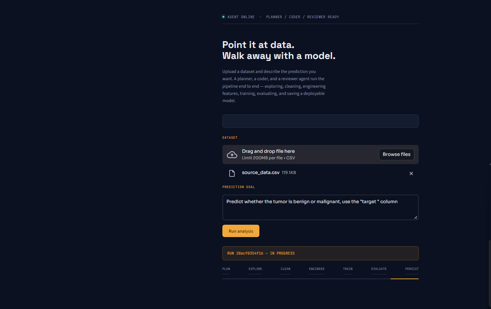
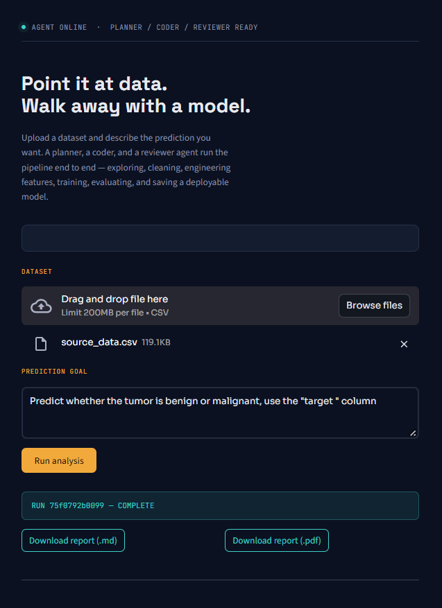
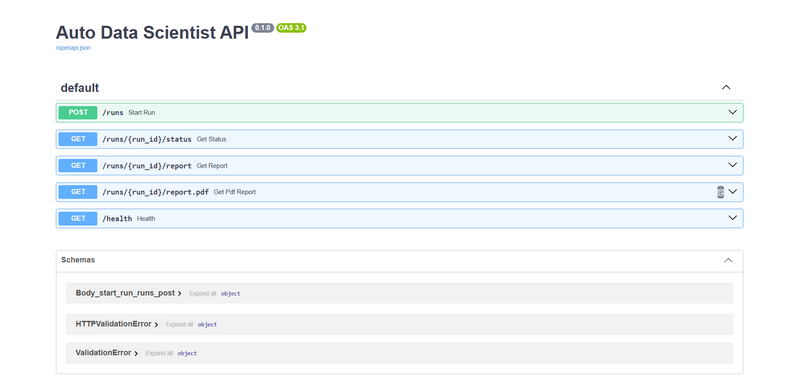
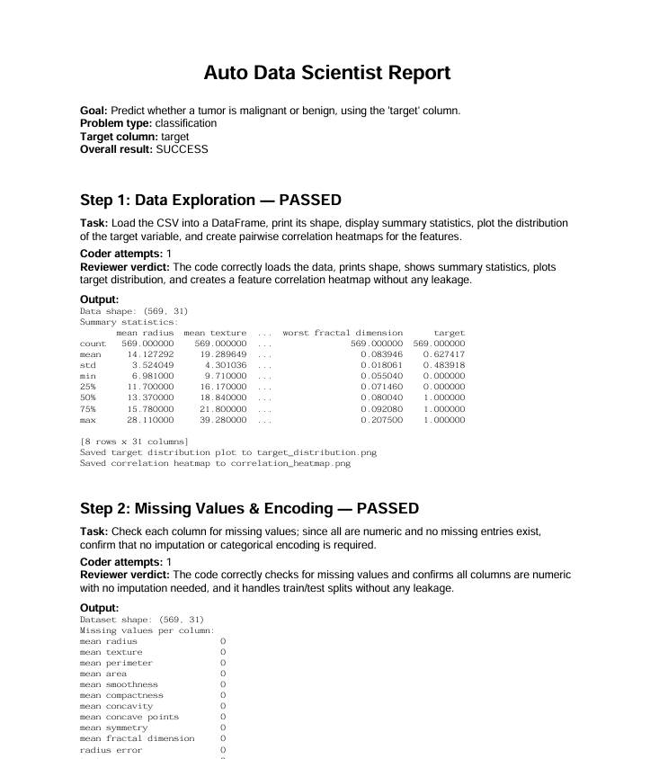
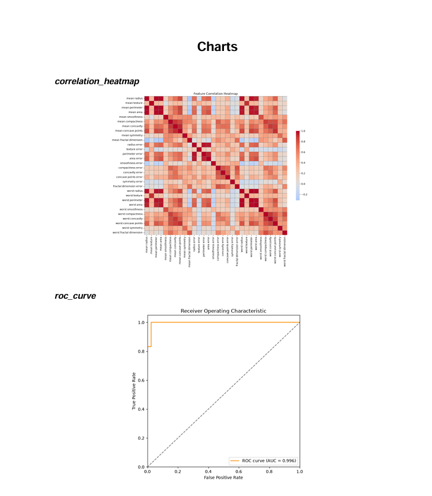

# 🤖 Autonomous Data Scientist Agent

A multi-agent system that takes a CSV and a plain-English goal — *"predict whether a tumor is malignant or benign"* — and autonomously explores the data, engineers features, trains and compares models, evaluates the result, and serializes a deployable model. A **reviewer agent** checks every step for correctness and data leakage before the pipeline is allowed to advance.

Upload a dataset, describe what you want predicted, and get back a trained model, an evaluation report (Markdown + PDF), and a full record of every decision the agents made along the way — including the mistakes they caught and corrected themselves.

> **Status:** fully functional end-to-end — agents, sandbox, orchestrator, tracking, API, UI, evaluation suite, CI, and Docker packaging are all built and tested against real runs.

---

## Table of contents

- [Why this exists](#why-this-exists)
- [Demo](#demo)
- [Architecture](#architecture)
- [How it works, step by step](#how-it-works-step-by-step)
- [Tech stack](#tech-stack)
- [Project structure](#project-structure)
- [How to run it](#how-to-run-it)
- [Evaluation results](#evaluation-results)
- [What broke, and how it was fixed](#what-broke-and-how-it-was-fixed)
- [Known limitations](#known-limitations)
- [Roadmap / what I'd build next](#roadmap--what-id-build-next)

---

## Why this exists

Most "AI agent" portfolio projects show a single happy path: one dataset, one run, one screenshot. This project is built differently, on purpose:

- **Every agent's output is checked by a second agent** before it's trusted — a reviewer combining a fast, deterministic leakage scanner with an LLM-as-judge.
- **Every pipeline run is logged, checkpointed, and reproducible** — MLflow tracking, resumable runs, and a full Markdown/PDF report per run.
- **The system is tested against its own failure modes, not just its successes.** The [What broke](#what-broke-and-how-it-was-fixed) section documents real bugs found by actually running the pipeline against real data — including genuine data-leakage bugs the reviewer caught, a cross-step data-loss bug, and an evaluation harness that silently graded the wrong number. That's a more honest signal of engineering depth than a clean demo, and it's the part of this README I'd point an interviewer to first.

## Demo

**The Streamlit app: upload, run, track progress, download results**


*Upload a CSV, describe the prediction goal, and watch the pipeline advance through plan, explore, clean, engineer, train, evaluate and persist.*


*When the run finishes, the status flips to COMPLETE and both the Markdown and PDF reports are ready to download.*

**The FastAPI backend: interactive API docs**


*`/runs`, `/runs/{id}/status`, `/runs/{id}/report`, `/runs/{id}/report.pdf` and `/health`, all testable directly from the browser.*

**A generated report**


*Each step's task, coder attempts, reviewer verdict, and captured output.*


*Charts produced by the agents are embedded in the report, including the final ROC curve (AUC 0.996) on the Breast Cancer benchmark.*

---

## Architecture

```
   CSV + goal (via Streamlit → FastAPI)
         │
         ▼
  ┌─────────────┐
  │   Planner   │   turns the goal + a data profile into a validated,
  │             │   ordered 4–7 step plan (Pydantic-checked JSON)
  └──────┬──────┘
         │
         ▼
  ┌─────────────┐     ┌──────────────┐
  │    Coder    │────▶│   Sandbox    │   isolated Docker container per run:
  │ writes code,│◀────│  (executes   │   no network, memory/CPU/time limits,
  │ self-repairs│     │  the code)   │   read-only filesystem
  └──────┬──────┘     └──────────────┘
         │ code ran successfully
         ▼
  ┌─────────────┐
  │  Reviewer   │   regex leakage scan  +  LLM-as-judge
  │             │   rejects bad steps with a specific reason,
  │             │   which is fed back to the coder for a retry
  └──────┬──────┘
         │ approved
         ▼
   next step, or:
   final model (.joblib) + MLflow run + Markdown/PDF report
```

**The orchestrator** drives this loop for every step in the plan: run the coder, run the reviewer, and on rejection, feed the reviewer's exact reason back into the coder's next attempt. It checkpoints after every approved step, so a crashed or interrupted run can resume (`resume=True`) instead of restarting from scratch — and it tracks a single, validated final metric (ROC-AUC) read from a contract file the coder must produce, rather than guessed by parsing printed text.

## How it works, step by step

1. **Plan.** The planner reads a short profile of the dataset (columns, types, missing values, a few example rows — never the raw data itself) and the user's goal, and returns a structured plan: explore → clean → engineer features → train & compare models → evaluate → persist.
2. **Execute, one step at a time.** For each step, the coder writes Python, which runs inside a locked-down Docker container. If it crashes, the error is fed back to the coder, which gets several attempts to fix its own mistake before the step is given up on.
3. **Review.** Once code runs successfully, the reviewer checks it — a fast regex scan for well-known leakage patterns (e.g. fitting a scaler before the train/test split), plus an LLM that reads the task, the code, and the output and judges whether it's correct, leak-free, and not suspiciously perfect. A hard regex match always overrides a lenient LLM verdict.
4. **Retry or advance.** A rejected step goes back to the coder with the reviewer's exact reason attached. An approved step's outputs (processed data, fitted transformers, models) become available to every later step.
5. **Report.** Once the plan completes, a full run record — every step's task, code, output, and review history (including any rejections along the way) — is turned into a Markdown and PDF report, and logged to MLflow.

## Tech stack

| Layer | Tools |
|---|---|
| Agents / orchestration | Python, an OpenAI-compatible LLM client (built and tested on Groq; swappable to any OpenAI-style provider), Pydantic |
| Sandboxed execution | Docker |
| ML | scikit-learn, XGBoost, pandas, numpy |
| Tracking & reporting | MLflow, ReportLab (PDF), Markdown |
| Serving | FastAPI (background tasks), Streamlit |
| Testing & CI | pytest, GitHub Actions |
| Packaging | Docker, Docker Compose |

## Project structure

```
auto-data-scientist/
├── src/
│   ├── sandbox.py              # Docker-based safe code execution
│   ├── llm.py                  # provider-independent LLM client, with retry/backoff
│   ├── profiler.py             # dataset → short text profile for the LLM
│   ├── schemas.py              # Pydantic models (the plan's shape)
│   ├── agents/
│   │   ├── planner.py          # goal → structured plan
│   │   ├── coder.py            # writes & self-repairs code for one step
│   │   └── reviewer.py         # leakage regex scan + LLM-as-judge
│   ├── orchestrator.py         # runs the full plan, checkpointing & retries
│   ├── tracking.py             # MLflow logging
│   ├── report.py               # Markdown + PDF report generation
│   └── evaluation.py           # benchmark suite runner
├── api/main.py                 # FastAPI backend
├── app/streamlit_app.py        # Streamlit frontend
├── tests/                      # pytest suite (sandbox safety tests)
├── Dockerfile.sandbox           # image the AI-written code runs inside
├── Dockerfile.api / .streamlit  # images for the app itself
├── docker-compose.yml
├── .github/workflows/ci.yml
└── runs/                       # per-run workspaces, reports, and MLflow data
```

## How to run it

### Prerequisites

- Docker Desktop, running
- An LLM API key for any OpenAI-compatible endpoint (built and tested against **Groq**)

Create a `.env` file in the project root:
```
LLM_BASE_URL=https://api.groq.com/openai/v1
LLM_API_KEY=your_key_here
LLM_MODEL=openai/gpt-oss-120b
```

### Option A — Docker Compose (recommended)

```bash
docker-compose up --build
```
- API: `http://localhost:8000` (interactive docs at `/docs`)
- Streamlit UI: `http://localhost:8501`

> **Note on the Docker socket:** the sandbox is launched via `docker run` from inside the API process. `docker-compose.yml` mounts the host's Docker socket (`/var/run/docker.sock`) so the containerized API can still start sandbox containers on the host — a common, well-known pattern, but worth knowing it gives that container access to the host's Docker daemon. Fine for local or portfolio use; a shared/production deployment would want a more isolated execution backend (see [Known limitations](#known-limitations)).

### Option B — run locally (two terminals)

```bash
# Terminal 1 — API
python -m uvicorn api.main:app --port 8000

# Terminal 2 — UI
streamlit run app/streamlit_app.py
```

### Run the tests

```bash
pytest -v
```
Runs automatically on every push via GitHub Actions, including a fresh build of the sandbox image on a clean Ubuntu runner — a meaningful check that the project is reproducible from scratch, not just "works on my machine."

## Evaluation results

The full pipeline was run end-to-end against real benchmark datasets, each scored against a known baseline.

| Benchmark | Agent ROC-AUC | Baseline | Result |
|---|---|---|---|
| Breast Cancer (binary classification, sklearn) | **0.9957** | 0.99 | ✅ matched/exceeded |
| Wine (3-class classification, sklearn) | **1.0000** | 0.99 | ✅ matched/exceeded |
| Telco Customer Churn (binary, 7,043 real-world rows) | **0.8416** | 0.837 (a model I hand-built in an earlier project) | ✅ exceeded |

The **Telco Churn** result is the one I'd highlight: a string-valued target (`Yes`/`No`), mixed data types, a non-predictive customer-ID column, and a genuine near-miss with target leakage that the reviewer caught and sent back for correction — and the agent still came out ahead of a model I built by hand.

A fourth benchmark (California Housing, regression) was attempted and intentionally dropped rather than forced: the current metrics contract only validates and reports ROC-AUC, which doesn't apply to a regression target. That's documented here as a scope limitation, not quietly worked around.

## What broke, and how it was fixed

Every item below was found by actually running the system against real data — none of these were anticipated in advance. I think this list is more informative than a feature list.

- **Sandbox safety, verified not assumed.** Automated tests confirm the sandbox genuinely blocks network access, kills infinite loops and memory bombs, and refuses writes outside its workspace — including catching that the memory limit needed to actually kill the container, not just time out.
- **A false positive in the leakage scanner.** The regex catching "fit before split" also flagged a *legitimate* final `.fit(X, y)` called after proper cross-validation — syntactically identical to real leakage, but correct depending on what ran earlier in the script. Fixed by exempting that pattern specifically when a `cross_val_score`/`cross_validate` call appears earlier in the same code.
- **A real leak the regex couldn't see at all.** `RFE` (recursive feature elimination) fit on the entire dataset *before* cross-validation — no `train_test_split` in sight, so no pattern-based check would ever catch it. The reviewer's LLM judgment caught it unaided; the fix was moving feature selection inside the cross-validated pipeline instead of running it beforehand.
- **Silent cross-step data loss.** A feature-selection step correctly selected its columns and saved the processed dataset — but as a bare NumPy array, dropping the target column along with everything else. The next step crashed looking for a column that was never saved. Fixed with a standing rule that any saved processed dataset must retain the target column under its original name.
- **Two incompatible models racing in the same workspace.** A subtler version of the same disease: a feature-engineering step trained and saved its *own* exploratory model, independently of the step actually responsible for model training. Two different, incompatible models ended up side by side, and a later step loaded the wrong one — a feature-name mismatch at prediction time. Fixed by explicitly forbidding feature-engineering steps from training or saving any model at all.
- **A reviewer that approved a near-random result.** One evaluation run technically passed every step but scored barely above chance on a 3-class problem. The model itself was actually fine (0.97 accuracy, 1.0 ROC-AUC) — the *evaluation harness* was reading the wrong printed line from stdout (an intermediate, already-rejected candidate model's score). Fixed by reading the metric straight from the orchestrator's own validated metrics contract instead of grepping printed text for anything that looked like a match.
- **Run status lost on every server restart.** The API tracked run status in an in-memory dictionary; any restart — including the `--reload` dev flag, which restarts on every file save — silently wiped all run history. Fixed by persisting status to a small JSON file per run and falling back to it whenever memory doesn't have the answer.
- **Opaque failures.** Early on, a failed run only reported "failed at step N," with no indication why. Fixed to surface the real cause: the reviewer's rejection text if the code ran but was rejected, or the actual stderr if the code never ran at all — which is also what made a Docker-not-running problem fast to diagnose instead of looking like a pipeline bug.
- **A library version drift.** `OneHotEncoder(sparse=True)` — valid in older scikit-learn, removed in newer versions, raising a `TypeError` on every attempt. Fixed with an explicit note in the coder's system prompt about the current parameter name (`sparse_output`).

## Known limitations

- **Regression isn't currently evaluable.** The metrics contract only validates ROC-AUC; a regression benchmark was deliberately dropped rather than forced through a classification-only contract.
- **The reviewer isn't perfectly consistent.** On at least one run, a persistence step's output was rejected on contradictory grounds by consecutive review calls — first for including too much data, then for including too little. A known, documented limitation of LLM-as-judge systems, not something papered over.
- **The containerized API needs the host's Docker socket** to launch sandbox containers. Works well for local or portfolio use; a shared or production deployment would need a more isolated execution backend.
- **Free-tier LLM providers have daily token limits** that can interrupt a long evaluation run. The retry logic handles rate limits and transient server errors automatically, but a hard daily cap requires waiting it out or switching providers.

## Roadmap / what I'd build next

- A multi-metric contract (accuracy, R², F1) so regression and other problem types are evaluable, not just classification via ROC-AUC
- A second, independent LLM-as-judge pass specifically to reduce the reviewer-inconsistency issue above (e.g. majority vote across two calls)
- Swap the Docker-socket-mounting pattern for a more isolated sandbox backend (e.g. a dedicated container-orchestration API) for anything beyond local/portfolio use
- A lightweight persistent database instead of the current file-based status/checkpoint system, for better concurrency if multiple users run the app at once

---

*Built as a personal project to go deep on agentic AI engineering: multi-agent orchestration, safe code execution, evaluation methodology, and production-adjacent concerns (observability, retries, API design) — not just prompting an LLM once and calling it done.*
